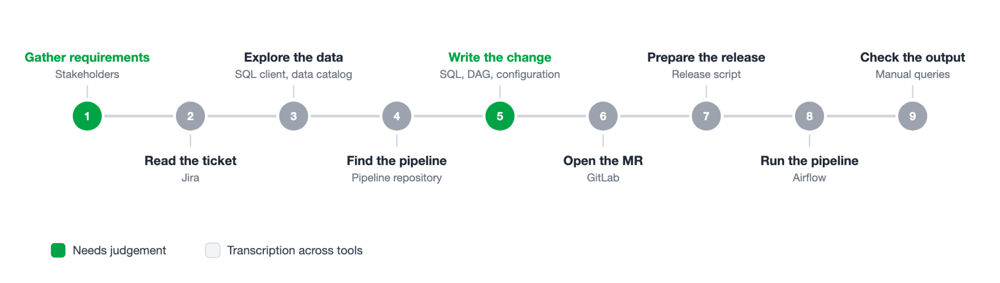
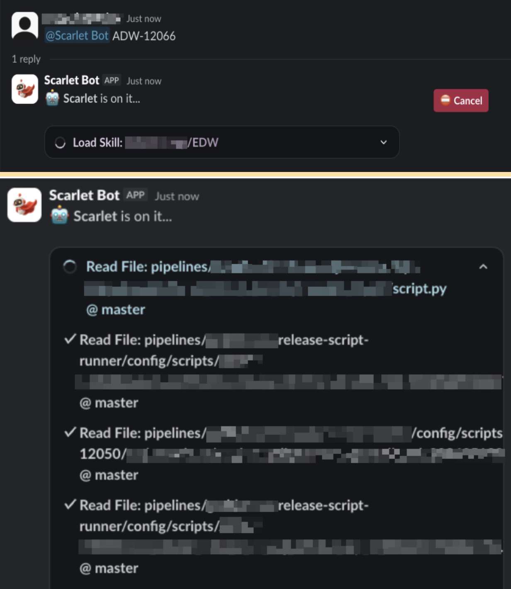
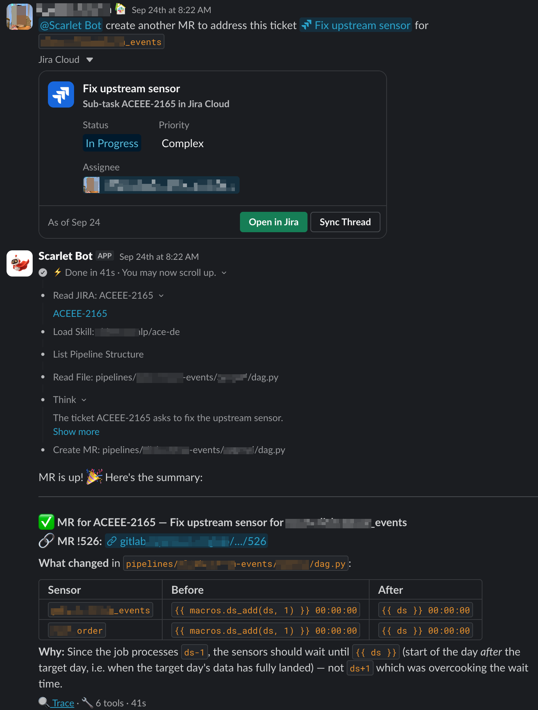
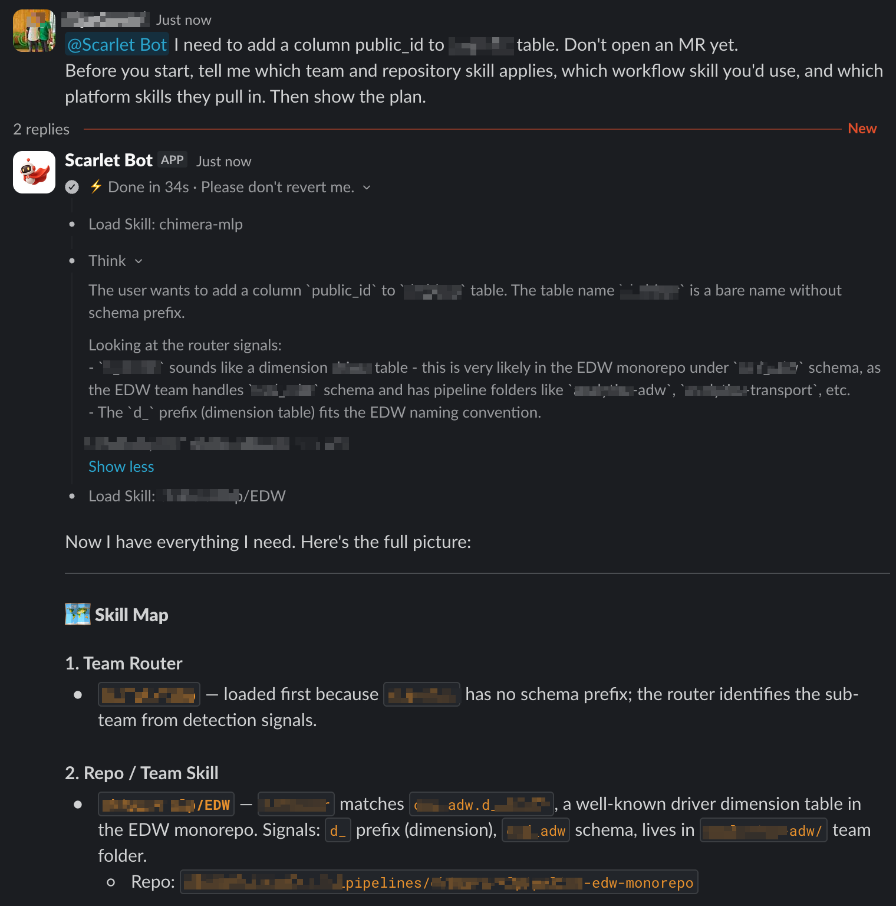
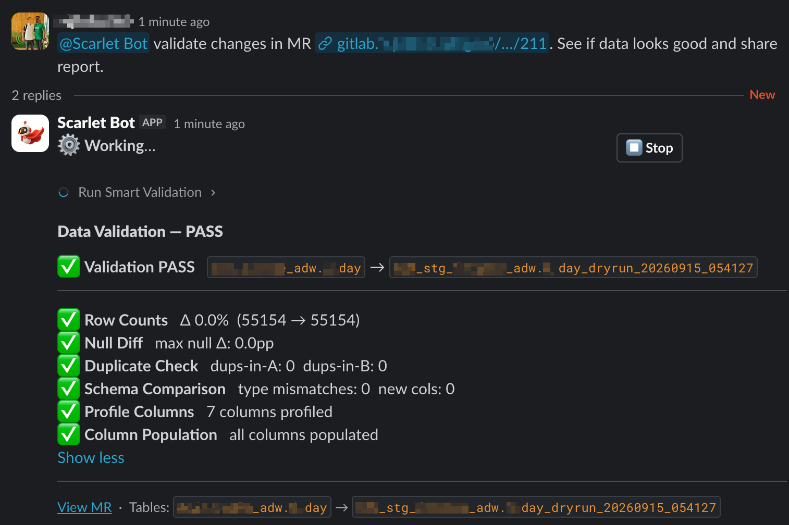
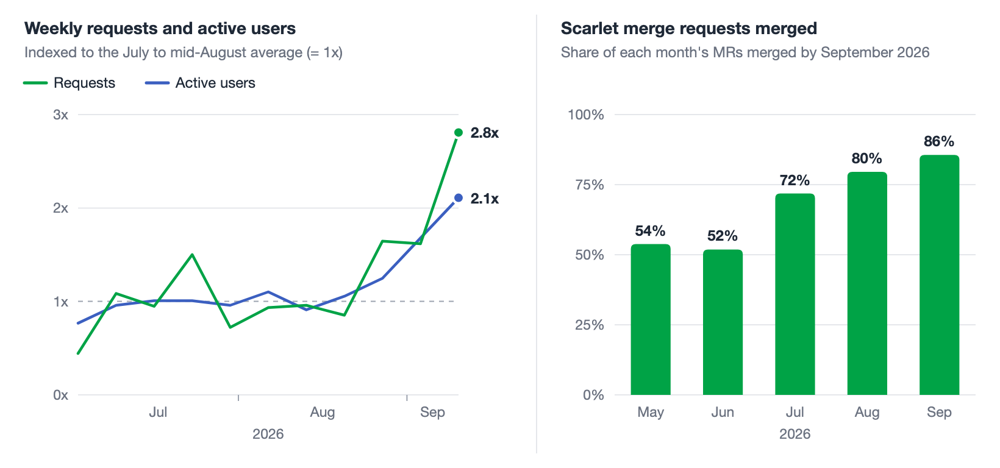

## Introduction

In the blog [From firefighting to building](https://engineering.grab.com/from-firefighting-to-building), we described the agents our Analytics Data Warehouse (ADW) team built to take routine work off data engineers. Scarlet was the Enhancement Agent in that post. It read a ticket, wrote the change, and opened a merge request (MR) for an engineer to review. A routine enhancement dropped from about a day to one or two hours.

<figure>
  <figcaption align="middle">Figure 1. A pipeline change without Scarlet.</figcaption>
  </figure>

Then other teams asked for it, and four limits became clear:

* **One team only:** Scarlet's repository and conventions lived in a single system prompt sent on every request. A second team meant forking the bot.
* **No proof the data was right:** Scarlet could run a change in a test environment, but nothing checked whether the output data was correct. That hour of manual validation still fell to a person, and it was the step most often skipped.
* **Shared access:** Early versions of Scarlet did not tie each action to the permissions of the person who requested it.
* **Slack only:** Every request needed someone to type it into a thread.

This post is about closing those gaps. We rebuilt Scarlet around a short core prompt and a library of skills: Markdown documents, one per capability or per team, loaded only when a request needs them. The prompt shrank about 25 times, and teams now review that knowledge like code. Scarlet also tests the data its changes produce, runs under the asker's own permissions, and takes work from Jira tickets and other agents.

Since this version reached production in May 2026, the repositories Scarlet ships to have grown about four times, weekly usage has roughly tripled, and the merge rate has climbed from about half to more than four in five. The merge still belongs to a person.

## What Scarlet does

To recap our initial blog: an engineer pastes a ticket into a Slack thread, Scarlet finds the repository and pipeline, checks the catalog, writes the change, and opens an MR for a human to review. That loop has not changed. Neither has the boundary: Scarlet has no merge or approve call, so merging stays with people.

Everything around that loop has changed.

In the thread:

* A plain-language description is enough. No ticket needed.
* Scarlet posts a plan before it touches a file.
* A live plan card shows each tool call as in progress, complete, or failed, with a cancel button.
* Follow-ups keep the earlier context, so "add one more column" needs no repetition.
* Attached files load as reference material, never as instructions.

In the MR: a structured description, a bot label, and the requester tagged and assigned. If the branch already has an open MR, Scarlet updates it instead of opening another.

<figure>
  <figcaption align="middle">Figure 2. Scarlet's live plan card during a pipeline build.</figcaption>
  </figure>

Scarlet now also works with the data catalog and the data quality platform, and handles far more scheduler actions than before. On each of them it follows one rule: show what it is about to do, then wait for a yes.

* **Catalog and data quality changes:** Scarlet posts the exact update it will write and waits for approval.
* **Scheduler actions:** Scarlet spells out which host, which directed acyclic graph (DAG), which run, and what it will do, then waits for approval.
* **Read-only requests:** no approval needed.
* **Data contracts:** Scarlet will not create one for a table whose quality checks are failing. A data contract tells downstream users the table is safe to depend on, and a table with failing checks is not.

Scarlet also answers questions about the data, such as how many rows landed yesterday. It runs those queries as the person asking and returns only aggregates, never per-person rows, under a hard cap that holds even if the model ignores its instructions.

## How the agent plans and acts

A request passes through four layers:

1. Slack carries the conversation and progress updates.
2. A reasoning loop picks the next action.
3. The skill library supplies the instructions for the current team and workflow.
4. An action layer reaches Jira, GitLab, Airflow, Google Docs and Sheets, and our internal data platforms.

<figure>
  <figcaption align="middle">Figure 3. How a Slack message becomes a merge request.</figcaption>
  </figure>

The first post described streamlining more than thirty verbose tool descriptions. Scarlet now goes further. Each internal platform sits behind a Model Context Protocol (MCP) bridge with two tools, one to list operations and one to call them, and schemas load only when needed. A platform with dozens of operations adds nothing to a request that never touches it.

Scarlet has two identities, split by what it touches:

* Data platforms (catalog, data quality, jobs, scheduler): Scarlet has no credentials of its own. Each operation runs as the requesting user through a short-lived token from their sign-in, so anything they cannot touch fails for Scarlet too.
* Source control: operations run as the Scarlet bot, so a machine-authored MR is easy to spot.

When a user asked how its access worked, Scarlet summed it up: "I can only do what you can do. I'm an accelerator for your own permissions, not a bypass around them."

Every reply ends with a footer linking to its full trace, so a reviewer can see exactly what Scarlet did and why.

## The skill library

Scarlet's core prompt contains no workflow detail. It tells the model to load the relevant skills before acting. Skills describe how to do the work, and tools do it.

Each skill is a Markdown document that defines one capability or one team's conventions, plus the skills it depends on. The table certification skill, for example, pulls in the catalog and data quality skills it relies on.

The library has four kinds of skill:

* Platform skills cover common operations, such as reading tickets, finding tables, and opening MRs.
* Routing skills work out which team and repository a request belongs to.
* Repository skills record a team's repository, schema ownership, scheduler, labels, and conventions.
* Workflow skills run end-to-end tasks: building pipelines, rewiring sources, certifying tables, validating data changes, and reviewing MRs.

<figure>
  <figcaption align="middle">Figure 4. Skill resolution.</figcaption>
  </figure>

A skill goes through the same life cycle as code:

1. An author writes or changes a skill and opens an MR. Scarlet can draft this MR itself.
2. Reviewers approve it the way they review code.
3. A pipeline validates the skill and publishes an immutable bundle.
4. At startup, Scarlet activates one bundle version and writes that version into its prompt, so every answer traces back to the exact instructions that produced it.

A new team joins by adding one repository skill. The library has roughly tripled since July. Much of that growth is team skills, and several of them were written by the teams that use them.

## Validating the data

Continuous integration (CI) proves that the code runs. It cannot prove that the data is right: a join that silently drops rows, a column that is suddenly half null, or a swap that overwrites yesterday's output all pass CI. Manual checks were easy to deprioritize, because they take longer and typically require familiarity with both Structured Query Language (SQL) and the tables involved.

Scarlet now tests the data as part of the change. This job used to belong to a separate validation bot, and we folded it into Scarlet. The flow:

1. During CI, our data platform runs the candidate change in an isolated environment and publishes a manifest linking the commit to the table it produced.
2. Scarlet reads the manifest, so it has real candidate output before anyone reviews the MR.
3. From the change, Scarlet works out what to compare: the target table, the changed columns, and the table's keys and partitions.
4. It runs its checks against the current production table.
5. It posts a verdict of pass, fail, or inconclusive, with evidence for every check, bound to the exact commit it tested.

The checks:

* Schema and type differences.
* Row counts.
* Duplicates and key reconciliation.
* Null rates and column profiles.
* Numeric statistics such as minimum, maximum, mean, and spread.
* Row-level differences between the two outputs.

The rules:

* The kind of change sets the mandatory checks, and requesters can add their own scenarios in the ticket.
* Inconclusive counts as a failure.
* If the change moves after testing, the verdict expires and the checks run again.

Automated checks can make MR validation and table comparisons less time-consuming than manual review.

We are extending the same flow past the merge. Scarlet will watch the first production run after an MR merges, rerun its checks against the live output, and, if they fail, raise a revert MR for a human to approve.

<figure>
  <figcaption align="middle">Figure 5. Testing a change's data.</figcaption>
  </figure>

## Beyond Slack

Not every request starts with a Slack message anymore. There are three ways in:

* Slack thread: the flow described above.
* Jira label: within about five minutes of a ticket being labeled for Scarlet, it picks the ticket up, starts a thread in its channel, tags the assignee, and works the ticket through to the MR.
* Command line and run application programming interface (API): engineers use Scarlet from a terminal, and coding assistants such as Codex and Cursor call it as a tool. The agent, its skills, and every credential stay on the server, and sign-in pauses work as they do in Slack.

## Seeing it in action

The first post walked through a single column change for our own team. These three cases show new kinds of work and new teams.

### Our own first pipelines

* **Ask:** onboard a new finance source system into the data lake, which needed many similar pipelines. An engineer described the task in a single message.
* **What Scarlet did:** read the source schema from the catalog, generated the transformation, DAG, and dependency files, and opened an MR within 30 seconds of the go-ahead. CI passed about five minutes later.
* **Result:** every pipeline that week passed CI on the first attempt, and almost all of the generated code shipped without rework. We estimate the work took around 6% of the engineer time it would have taken by hand.

### The first merge request outside our team

* **Ask:** an analytics engineer on a commerce team, in their first week with Scarlet, wanted five fields added to a clickstream table.
* **What Scarlet did:** opened the MR, then its own review pass flagged that the field names broke the upstream team's convention. The engineer picked the convention, and Scarlet updated the MR and the ticket.
* **Result:** a reviewer merged it the next day.

### A team onboarded mid-request

* **Ask:** an engineer on a lending analytics team, using Scarlet for the first time, wanted a scheduled job changed for a team Scarlet had never been set up for.
* **What Scarlet did:** when the engineer typed "onboard my team to Scarlet", it drafted the team's skill as an MR. After a single sign-in, it updated the job under the engineer's identity and ran its post-change checks.
* **Result:** the skill MR merged the next day, and the job change went through under the engineer's own permissions.

## Lessons from production

### Templates for predictable structure

What happened: during one migration, Scarlet produced a large MR that passed CI and failed at runtime. The model had guessed part of the job configuration.

What we changed:

* Deterministic scaffolds for predictable structures. They run the platform's own code generator and validate the output against a contract.
* A Slack wizard for teams that prefer forms. It never calls the model and captures all the necessary details as required.
* A validate, lint, fix loop for generated SQL and configuration. It stops after a few failed attempts and asks a human.
* The model keeps only the work that needs judgment: mapping columns, writing transformations, explaining failures.

### Sign-in as a pause

What happened: when Scarlet acts as the user, some platforms need that user to sign in first. At first, hitting one of those mid-run ended the workflow, and replaying the request lost the progress.

What we changed: sign-in is now a pause. The run checkpoints at a LangGraph interrupt, and the sign-in callback resumes it from that point while the same plan card keeps updating.

### Measuring without reading conversations

What happened: the first post's feedback loop ran on reviewers rating each answer in Slack. Scarlet's output is an MR reviewed in GitLab, so that loop did not carry over, and after launch we could not say who used Scarlet, for what, or how often it succeeded.

What we changed: a recorder that captures metadata from the tool stream (requester, source, skills, tools, duration, outcome, intent) without storing conversations. Request text is opt-in, and anything that looks like a credential is redacted. The figures below come from it.

## Impact

These figures come from the usage events Scarlet records.

<figure>
  <figcaption align="middle">Figure 6. Weekly usage and merge rate, May to September 2026.</figcaption>
  </figure>

* Weekly usage held steady from July to mid-August, then climbed. In the week of 7 September it reached about three times the usual request volume from about twice as many users, and the following week held near twice the usual level.
* The share of monthly users who came back for a second week rose from about 42% in July to 56% in August and stayed above 50% in September. The top user's share fell from nearly half of all requests to under 10%.
* Repositories with a Scarlet MR grew about fourfold from May to September, and monthly MRs opened grew more than fourfold from June to September. The merge rate rose from about 50% in May to over 85% in September. Early September alone produced more merged code than the whole of August.

The mix of requests changed as the skill library grew:

* Table discovery grew fastest, more than six times from July to September, as new teams explored the catalog before asking for changes.
* By September about half of all requests were questions about the data, not changes. Answering under the asker's own permissions turned out to matter as much as the merge boundary.

## Current limits

* Long threads degrade answer quality, and a very large request can exceed a single model turn. Starting a new thread helps once older context stops being useful.
* Coverage gaps: schema and freshness checks only, certification for production tables only, and source rewires stop for a human when fewer than about 70% of columns can be mapped.
* Data testing covers code-pipeline changes. Batch-job changes still need an isolated test environment first.

The biggest open problem is uncertainty. When repository conventions do not settle a configuration choice, Scarlet sometimes proceeds without asking. The next step is to make that rule explicit in the skills and check it with regression tests on every release.

## Takeaways

Slack made the work visible. The skill library made it maintainable: a new repository no longer needs a new agent, and teams review the files that hold their conventions. If you are building something similar, keep the model for the judgment calls and write every convention down as a file someone can review.

## What's next

The first post drew the line at anything that changes production: those actions wait for a human. With CI and data validation now in place, we think that line can move for routine work. Now that requests can start from tickets or other agents, every Scarlet MR will pass through one risk-based approval gate:

1. CI passes.
2. Scarlet's data validation returns pass. A fail or inconclusive verdict goes to a human.
3. The change is routine. New pipelines, rewired sources, and data contract changes always go to a human.
4. A change that passes all three checks could move through review faster, with an engineer still making the final call to merge.

## Join us

Grab is Southeast Asia's leading superapp, serving over 900 cities across eight countries (Cambodia, Indonesia, Malaysia, Myanmar, the Philippines, Singapore, Thailand, and Vietnam). Through a single platform, millions of users access mobility, delivery, and digital financial services, including ride-hailing, food delivery, payments, lending, and digital banking via GXS Bank and GXBank. Founded in 2012, Grab's mission is to drive Southeast Asia forward by creating economic empowerment for everyone while delivering sustainable financial performance and positive social impact.

Powered by technology and driven by heart, our mission is to drive Southeast Asia forward by creating economic empowerment for everyone. If this mission speaks to you, [join our team](https://www.grab.careers/en/) today!
