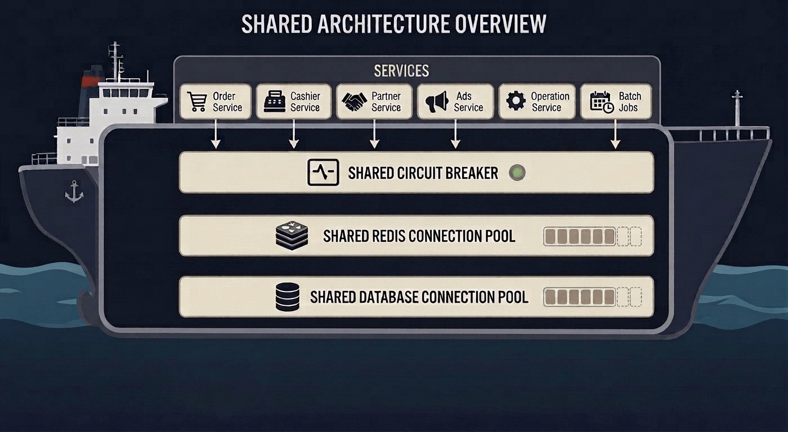
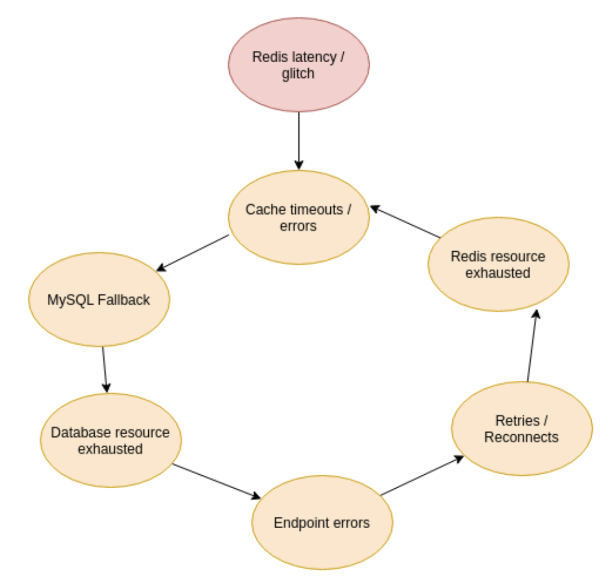
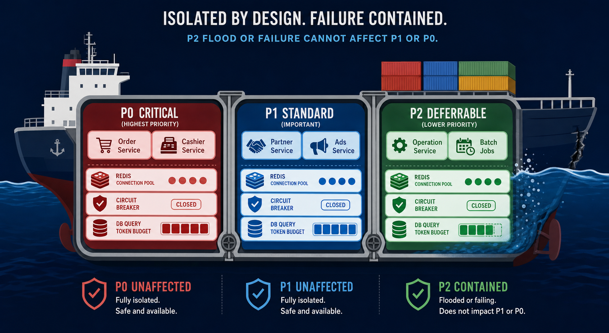
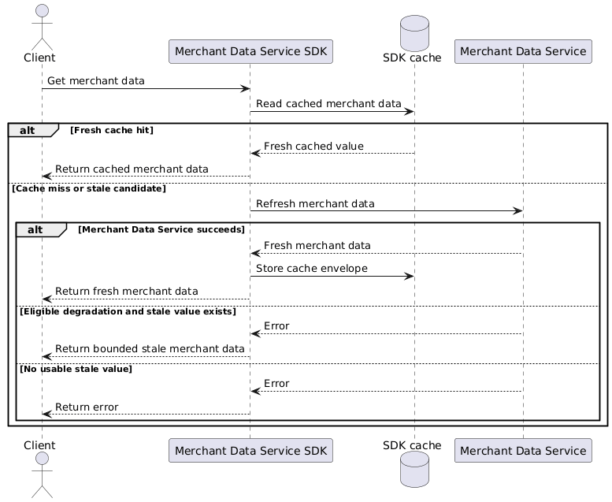
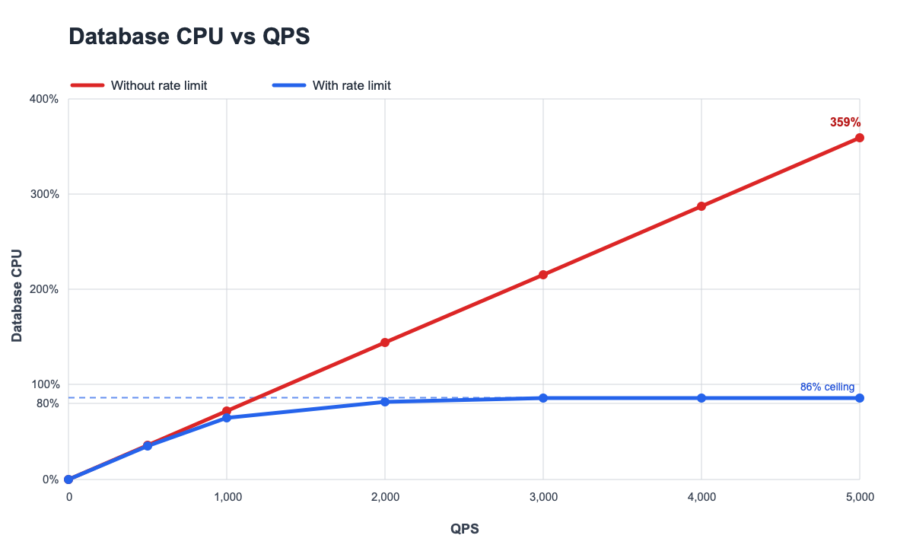
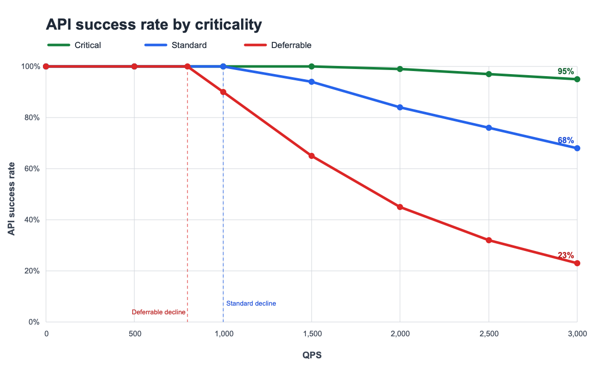

## Introduction

When a cache becomes unreliable, a shared read service can struggle in ways that spread to the systems that depend on it. We saw this pattern in our merchant data service (MDS). Cache reads began timing out, fallback requests increased database pressure, and service availability degraded.

The trigger was localized; the broader impact came from how each layer responded, passing more work downstream instead of containing the failure.

That amplification follows a predictable pattern, and a few design changes help MDS degrade instead of collapse. The central lesson is simple: a fallback is not a safety net unless its work is bounded.

## The merchant data service and its cache

MDS is a shared read service for merchant information. Many client applications use it for questions such as "Is this outlet open?", "Does this merchant accept orders manually?", and "What are this merchant's settings?". It supports a range of product and operational workflows and handles high-volume, read-heavy traffic. Because merchant data generally changes less frequently than it is read, MDS uses a cache-aside design:

<figure>
  <figcaption align="middle">Figure 1. The cache-aside read path. The database is the source of truth; the cache serves most reads.</figcaption>
  </figure>

In normal operation, this works well. The database sees only cache misses, which are a small fraction of traffic. The design depends on one assumption that is rarely written down: that cache failures look like cache misses only occasionally. Without bulkheads, the service is like an undivided ship where a small hull breach (a minor cache glitch) lets water flood unchecked into every compartment, quickly sinking the whole vessel under a sudden wave of database requests it was never built to carry.

## Anatomy of a cascading failure

A cache disruption caused reads to time out and fall back to the database. As fallback demand rose, database errors and connection pressure increased; callers then saw more failures, and service availability dropped.

This followed a sequence that the [Google SRE book](https://sre.google/sre-book/addressing-cascading-failures/) describes as a cascading failure: a local fault triggers a response that increases load, which causes more faults. When cache reads slow or fail, each miss adds database work. As the database slows, callers time out. Retries then add more load to the already degraded path, turning a local cache problem into a feedback loop.

<figure>
  <figcaption align="middle">Figure 2. A cache problem can increase downstream load and widen service degradation.</figcaption>
  </figure>

Recovery took longer because retries and connection pressure kept adding load while the cache and database tiers were constrained. Temporary mitigations reduced symptoms, but the system needed restored headroom and lower incoming pressure before it could recover. Those actions addressed the immediate disruption, not the underlying risk: a cache failure could still send excessive, unprioritized work to shared dependencies.

Short-term client and request-path changes reduced exposure to the immediate trigger. The core vulnerability remained: a dependency failure could still flood shared resources with unbounded, unprioritized work.

## The questions the redesign had to answer

The cascade exposed three gaps: cache errors followed the same path as normal misses; fallback work had no firm admission bound; and callers with different business impact competed for shared capacity. Those gaps left the redesign with five questions.

1. Which requests should survive when capacity is scarce?
2. How much cache-fallback traffic may reach each database?
3. How do we stop one workload class from exhausting resources used by another?
4. Do all clients need real-time data, or can their use cases tolerate a bounded delay in seeing updates?
5. Can callers use a recently observed value when fresh data is temporarily unavailable?

These five questions point to a clear objective: preserve interactive reads while shedding work that can wait. Our core design principles include:

* Keep interactive reads available for as long as capacity allows.
* Shed background and batch work before user-facing work.
* Bound database work caused by cache failures.
* Fail fast when a dependency is saturated instead of building an unbounded queue.
* Serve stale data only on approved read paths with explicit freshness limits.
* Give on-call engineers scoped controls that do not require a deployment.

Five mechanisms put these principles into practice, starting at the database boundary and working outward to the client application.

### Step 1: Know who is calling and how much it matters

Prioritizing work requires knowing a request's relative impact. Instead of relying on caller-supplied labels, MDS derives a request class from authentication. The table below shows the categorization of incoming traffic by operational criticality.

| Class | Meaning |
| :---- | :---- |
| **P0 (Critical)** | Interactive reads with direct user impact, such as the consumer app's API |
| **P1 (Standard)** | Routine production reads |
| **P2 (Deferrable)** | Background, batch, and unclassified work that can wait |

Clients without an explicit policy receive the lowest-priority class by default. The default stops new or unclassified callers from claiming scarce capacity; promotion requires a reviewed policy change, not a code change. Downstream controls use the same class so the database limiter, circuit breakers, cache connections, and traffic controls make consistent decisions.

### Step 2: Put a budget in front of the database

The key change is an admission controller immediately before the database on the cache-fallback path. Each fallback query must acquire capacity from a shared token budget before running. If capacity is unavailable, the request is rejected promptly instead of joining a queue for an already saturated database.

**Separate budgets for distinct workload roles.** Independent limits protect different database workloads so that pressure in one area does not consume all capacity available to another. The overall budget is coordinated across service instances and managed through runtime configuration.

**Cost reflects query shape and priority.** Each fallback consumes capacity according to the work it is expected to perform. Lower-priority work carries a higher relative cost than interactive point lookups. The cost relationship is illustrative, not a production setting. The table below displays illustrative token costs. In production, these values are set through runtime configuration.

| Query type | Base cost | P0 total | P1 total | P2 total |
| ----- | ----- | ----- | ----- | ----- |
| Point lookup by ID | 1 | 1 | 2 | 3 |
| Indexed find or range seek | 3 | 3 | 4 | 5 |

Under contention, a more expensive lower-priority query uses its share faster than a point lookup from an interactive caller. Weighting gives higher-impact work a better chance to proceed, but it does not reserve capacity. If interactive demand itself exceeds the shared limit, some interactive requests may be rejected too. A shared weighted budget avoids leaving capacity idle when one class has less demand.

**P2 (deferrable) requests do not use the fallback during cache errors.** When a cache read fails because of a dependency error, not an ordinary miss or invalid data, the P2 class is rejected before reaching the database limiter. Rejecting P2 early preserves more database budget for interactive and routine work during a broad cache disruption.

### Step 3: Bulkheads for connections and failure signals

Admission control limits *how much* work reaches the database. Bulkheads limit *who can starve whom* along the way. The name comes from the watertight compartments in a ship's hull: a breach floods one compartment, not the ship.

**Separate cache connection pools by request class.** MDS routes requests through independent pools based on their relative impact. Slow background reads can exhaust their own pool without consuming connections needed by interactive traffic. Separate pools help most when slow operations hold connections longer and pool exhaustion could turn slowness into failure.

**Separate circuit breakers by request class.** Failures in lower-priority traffic do not automatically block interactive work; each class is evaluated against its own observed errors. A shared dependency failure can still affect every class.

<figure>
  <figcaption align="middle">Figure 3. Bulkhead architecture of a shared read service.</figcaption>
  </figure>

Together, these controls help contain localized cache faults and noisy workloads. Bulkheads reduce interference while capacity remains; they cannot preserve service if the underlying database is unavailable.

### Step 4: Give responders a scoped control

Automatic controls address anticipated failure modes, but incidents can reveal new scenarios. A useful response is the ability to reduce traffic from a particular client or workload without waiting for a code release.

MDS supports scoped traffic controls managed through centrally controlled runtime configuration. Rules can target progressively broader scopes. The patterns below are illustrative:

| Scope pattern | Targeted request group |
| :---- | :---- |
| client:endpoint | A particular client and operation |
| criticality:endpoint | A request class accessing a particular operation |
| criticality: | An entire request class |

Matching policies can be applied gradually by percentage instead of as an all-or-nothing block. Throttled requests receive a standard unavailable response. Health checks remain exempt so health-based routing can continue. Responders can adjust the scope and level of protection during an incident without a code deployment.

### Step 5: Move safe degradation closer to callers

Everything so far protects MDS from load. Callers can also amplify failures: retries and synchronized cache expiry may add pressure while MDS is recovering. Server-side shedding can turn excess traffic away, but a rejected request is still a failed request for the user behind it.

For some relatively stable fields, a recent value may be preferable to an error. More time-sensitive data may require stricter freshness limits or must always be read fresh. The MDS client software development kit (SDK) now includes an opt-in cache that lets approved read paths make this trade explicitly, with a bounded freshness policy.

**Every cached value carries its own freshness window.** The SDK stores freshness metadata alongside each value, including when it was stored and the boundaries for fresh and approved-stale use. Cache retention covers only that bounded window, while the SDK decides whether the value may be served. Keeping the metadata with the value makes the same policy work across supported cache backends.

<figure>
  <figcaption align="middle">Figure 4. SDK reuses known values and serves approved stale data.</figcaption>
  </figure>

## What the tests and production data showed

### Admission control limits database fallback

In controlled load tests, admission control rejected excess fallback work before it reached the database. The limiter kept database work within its configured budget as offered load increased, trading some request success for lower database saturation.

Under heavy offered load in these tests, average database central processing unit (CPU) use was lower with the limiter than without it.

<figure>
  <figcaption align="middle">Figure 5. Database load under increasing offered traffic in a controlled test.</figcaption>
  </figure>

### Priority controls shed lower-priority work first

Tests showed that the controls shed work by priority rather than rejecting all callers equally.

**Isolated circuits.** Lower-priority work gave way first, while interactive reads remained subject to their own limits.

**Database admission control.** A shared weighted budget can give higher-impact work more opportunity to proceed, but it does not reserve capacity. Interactive requests can still fail when the shared dependency is exhausted.

<figure>
  <figcaption align="middle">Figure 6. Priority-based request handling under increasing load.</figcaption>
  </figure>

### The SDK cache reduced repeated reads

In the read paths that adopted it, client-side caching reduced the number of requests reaching MDS at peak. Reads served from the cache returned faster than those that needed a network call, and caching eased load on the cache tier and the application. When fresh reads were temporarily unavailable, clients could fall back to approved stale values instead of failing.

## What we learned

* **Every fallback needs a bound.** The cache-to-database fallback was designed as a safety net and behaved like an amplifier. A fallback without a budget spreads failure instead of containing it. The same applies to stale data: it is safe only inside an approved freshness window.
* **Isolation must follow impact, not topology.** Physical separation alone was insufficient when callers still shared the same controls. Isolating by workload impact lets the service choose which work is most likely to survive.
* **Latency and queues are failure signals.** Incidents can begin with rising latency before visible errors emerge. Timed-out work still consumes capacity, and a retry against a saturated dependency is extra load, not recovery.
* **Test the controls together.** Circuit breakers, limiters, retries, cache expiry, and stale serving interact, and failures often come from how they combine. Testing them together under realistic overload reveals interactions that testing one at a time can miss.

## What comes next

These controls currently focus on MDS and its client SDK. Looking ahead, we are exploring ways to improve coordination across layers, align admission decisions with current capacity, manage retry budgets end to end, and carry server-validated request priority to downstream dependencies.

## Closing thoughts

A shared service cannot make its dependencies infallible. Cache systems can fail, and databases can run out of headroom. What the service controls is how much work it sends toward a failing dependency, whose work goes first, and what callers do when an answer is delayed. By bounding fallback work, isolating callers by impact, rejecting excess demand early, and serving stale data only on approved paths, MDS is better able to contain cache disruptions without turning them into broader service unavailability.

## Join us

Grab is Southeast Asia's leading superapp, serving over 900 cities across eight countries (Cambodia, Indonesia, Malaysia, Myanmar, the Philippines, Singapore, Thailand, and Vietnam). Through a single platform, millions of users access mobility, delivery, and digital financial services, including ride-hailing, food delivery, payments, lending, and digital banking via GXS Bank and GXBank. Founded in 2012, Grab's mission is to drive Southeast Asia forward by creating economic empowerment for everyone while delivering sustainable financial performance and positive social impact.

Powered by technology and driven by heart, our mission is to drive Southeast Asia forward by creating economic empowerment for everyone. If this mission speaks to you, [join our team](https://www.grab.careers/en/) today!
