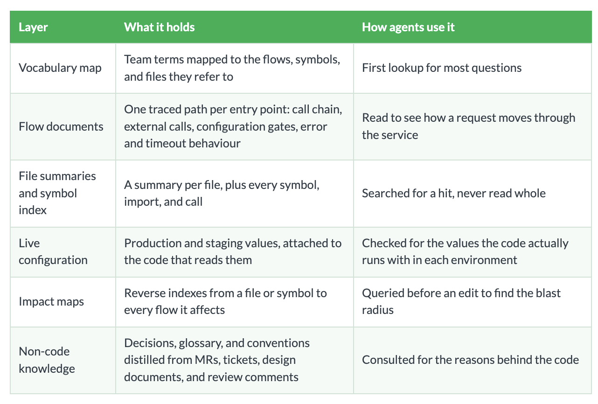
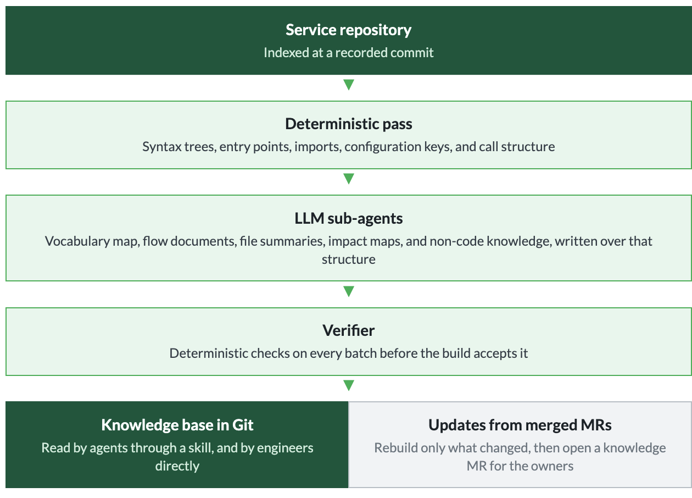
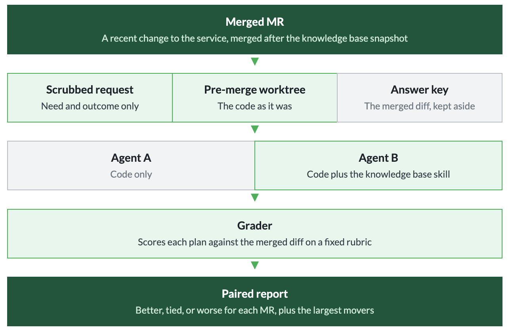
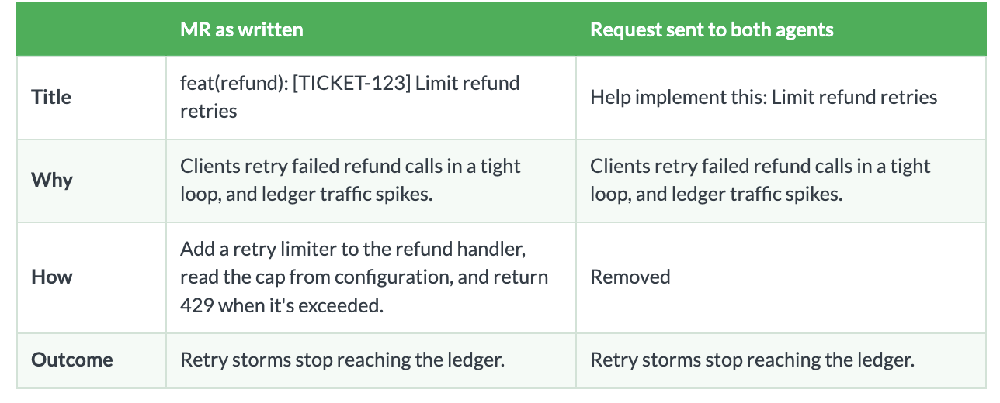
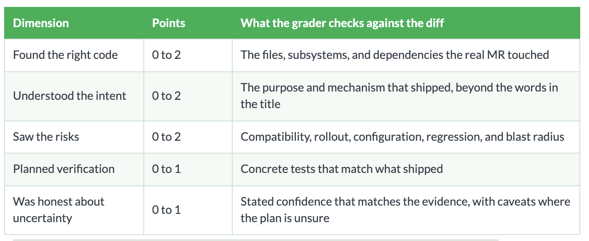
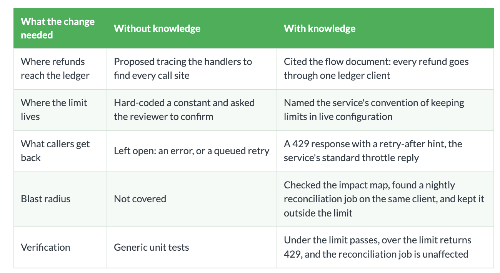
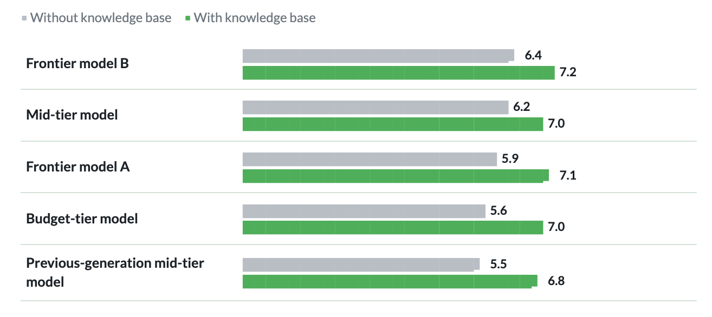
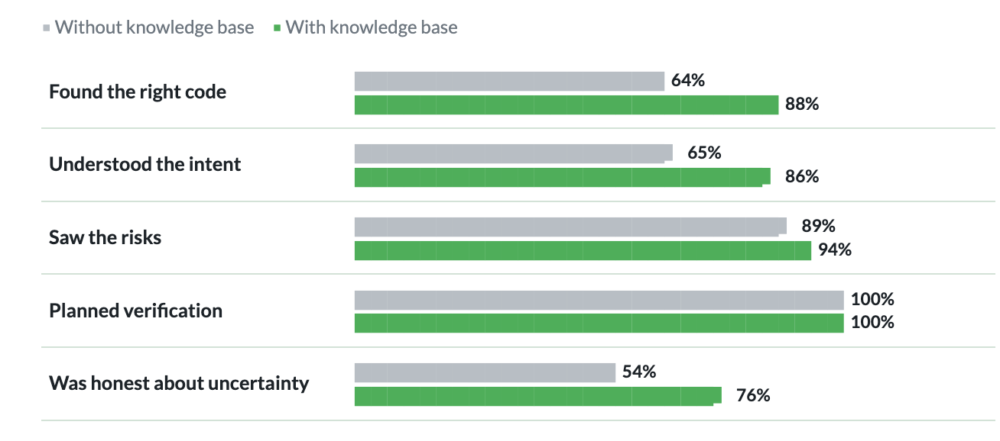
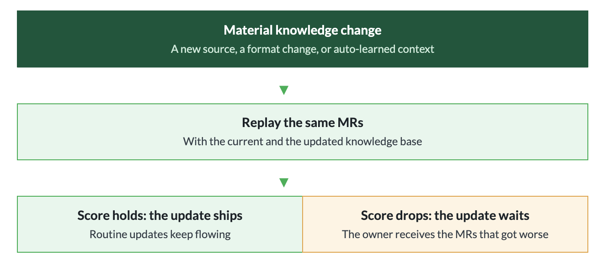

## Introduction

Every session, you get a new teammate: a coding agent. It reads code faster than you and has seen more of it than your whole team put together. What it does not have is any memory of how your service got this way.

It can see what the code does. It cannot see why a limit lives in configuration, which nightly job breaks if you touch a shared client, or what an old review thread settled. So it asks, or it guesses.

We built a knowledge base to fill that gap. For each backend service, it maps how requests move through the code, what a change could break, which configuration values the code runs with, and why the team made the calls it did. Agents load it before they touch a service.

The harder part was knowing whether it helped. A plan that reads well can still be wrong, and every agent session starts from scratch, so you cannot watch an agent improve the way you watch a new hire settle in. We found the answer key in our Git history.

## Why context is hard to judge

It is easy to keep adding context, and every new file feels like progress. Each one also takes up some of the agent's attention, can contradict something else it was told, and starts going stale the day it lands. More context can leave an agent worse and more expensive at the same time.

We wanted a number for three reasons:

1. **Opinions do not add up.** Ask an engineer or a large language model (LLM) whether a piece of context is useful and you will get an opinion. Ten opinions will not tell you which of ten additions helped.
2. **Public benchmarks measure something else.** They test models on public repositories, which the models may have seen in training. [Grab Bench](https://engineering.grab.com/grab-bench-evaluating-ai) tests models and agents on Grab-shaped work. We wanted to hold the model fixed, change only the context, and measure the effect on our own code.
3. **Our knowledge base updates itself.** It changes whenever a merge request (MR) lands, and we are adding design documents and discussion threads as sources. Anything that rewrites itself that often needs a check before each update goes live, and a check needs a score.

## What the knowledge base holds

For each backend service, an offline build reads the code and writes a set of structured files. Agents pull them in through a skill, a packaged set of instructions they load when a task needs it, and engineers read the same files directly. Any factual claim an agent makes from them has to cite a file and line.

We build it in two passes. The first is plain code analysis with no LLM involved. It parses the service into syntax trees and extracts entry points, imports, configuration keys, and the actual call graph. Only then do LLM sub-agents write summaries and flow documents on top of that structure, and a verifier checks each batch before the build accepts it. The model is describing a call graph we handed it, so it never has to guess one.

<div class="post-image-section"><figure>
  <figcaption align="middle">Figure 1a. Layers in a service knowledge base and how agents use them.</figcaption>
  </figure>
</div>

<div class="post-image-section"><figure>
  <figcaption align="middle">Figure 1b. How a service knowledge base is built and kept current.</figcaption>
  </figure>
</div>

Two details matter for the evaluation. The knowledge base lives in Git, so every change to it is a reviewed diff. When MRs merge, an update job rebuilds only the files and flows they touched and opens a knowledge MR for the service owners to approve. Every build also records the commit it indexed, which gives the test a clean cutoff.

The first build indexes the whole service, and later updates rebuild only what changed. We use this approach across a growing number of our backend services.

## Every merged change is an exam with an answer key

Every merged MR is a solved problem. Someone wrote it, someone reviewed it, and it shipped. Rewind the repository to the commit just before the merge, give an agent the same request with the solution stripped out, and the merged diff becomes the answer key. Traders do something similar with backtesting. Before trusting a strategy with real money, they run it against history, where every outcome is already known.

<div class="post-image-section"><figure>
  <figcaption align="middle">Figure 2. The replay loop. Both agents start from the same request and the same pre-merge code. Only one line in their prompts differs.</figcaption>
  </figure>
</div>

Each run has six steps:

1. **Select.** Take recent MRs that changed the service and merged after the knowledge base snapshot.
2. **Scrub the request.** Rebuild the request from the MR title and the text that states the need and the expected outcome. Strip file paths, links, code, and anything that describes the solution.
3. **Rewind.** Create an isolated Git worktree at the exact pre-merge commit.
4. **Plan twice.** Run two identical agents on the same code with the same time budget. Agent A plans from the code alone. Agent B's prompt has one extra line that turns on the knowledge base skill.
5. **Grade.** An LLM grader scores each plan against the merged diff on a fixed rubric.
6. **Pair.** Compare the two scores for each MR, then aggregate across the set.

```
for mr in select_mrs(service, merged_after=kb_snapshot_date):
    ask = scrub(mr.title, mr.description)        # need and outcome only
    repo = worktree_at(mr.parent_commit)         # the code as it was before the merge
    answer_key = mr.diff                         # never shown to the agents

    plan_a = agent.plan(ask, repo)                             # code only
    plan_b = agent.plan(ask, repo, skills=[knowledge_base])    # the only difference

    for variant, plan in (("a", plan_a), ("b", plan_b)):
        record(mr, variant, grader.score(plan, answer_key, rubric))

report(paired_means(), better_tied_worse(), largest_movers())
```

*The following is illustrative pseudocode. The function and variable names are simplified.*

The agents write a plan, not code. A plan lists which files to change and how, the risks, how to verify the change, and how confident the agent is. We stopped at the plan on purpose. Writing a change takes two skills: working out what it needs, and then writing it correctly. The knowledge base is there to help with the first, and a plan shows that part directly, without the model's coding ability moving the score. Code has many right answers, and two correct implementations rarely match line for line, so diffing an agent's code against the merged code would penalise valid alternatives. Plans are also quick to produce, so we can rerun a full 50-MR sweep with both variants whenever something changes.

A good plan still is not working code. It can be implemented badly, and some mistakes only show up when the code runs. We have also run the replay with agents writing code, but the results here cover plans only.

## Making the test fair

It is easy to build a replay test that looks fine and measures nothing. Five decisions keep ours honest.

### Grade against what shipped

Plans do not come with tests, so an LLM grades them, and LLM graders are easy to impress. A fluent, confident plan can score well while missing the point entirely. Our grader always has the merged diff in front of it, and every point it gives has to trace back to that diff. A plan that sounds right but misses what shipped scores low.

### Keep the answer out of the exam

A test like this fails quietly when the answer leaks in. We close four paths:

* **Through the knowledge base.** A knowledge base built after an MR merged may already describe that change. We only replay MRs that merged after the snapshot, so the knowledge always predates the answer.
* **Through the request.** MR descriptions often spell out the solution. The scrubber keeps the need and the expected outcome, and strips file paths, links, code, function names, and sections like "implementation" or "changes made". If nothing usable is left, a separate LLM call rewrites the request with one rule: describe the need and the outcome, never the approach.
* **Through the repository.** Agents work in a worktree at the pre-merge commit and are told not to look up the MR, its diff, or later history. The answer keys live outside the worktree.
* **Through the grader.** Each grader sees one plan and the diff. It never sees the other variant's plan, so it cannot grade on a curve.

Here is what the scrub does to a made-up MR:

<div class="post-image-section"><figure>
  <figcaption align="middle">Table 1. Example scrub of a made-up MR request. Illustrative only.</figcaption>
  </figure>
</div>

### Choose changes worth planning

Some MRs have nothing to plan, and a set full of them drifts towards ties. The selector skips reverts, dependency bumps, test-only changes, file moves, MRs that mostly touch code outside the service, and single-file changes under about 15 lines. What is left is work an engineer would have to think through.

### Use a rubric a reviewer would recognise

Each plan can earn up to 8 points across five dimensions, based on what a human reviewer checks:

<div class="post-image-section"><figure>
  <figcaption align="middle">Table 2. Rubric dimensions and maximum points.</figcaption>
  </figure>
</div>

Three rules shape the scores:

* **Every point traces to the diff.** Confidence on its own earns nothing.
* **Open decisions are capped.** The failure we saw most often was an agent handing a core decision back to a human. A plan that does that scores at most 1 on each of the first two dimensions.
* **Scoring is award-only.** Correct extra scope costs nothing, and wrong scope earns nothing.

The grader explains every score with references to the plan and the diff, and we read the biggest score changes and the edge cases ourselves.

### Change one thing, then repeat

The two agent prompts differ by a single line. The MR, the code, the request, the time budget, the grader, and the rubric all stay the same, so any change in score comes from the knowledge base.

The same setup works for other comparisons. Swap the model or the agent harness instead, and the same MRs and grader measure that. Our first sweep ran five agent stacks from three model providers, each with and without the knowledge base, so the scores also compare across stacks.

Agents are probabilistic, so a single run is just one sample. We average repeat runs for each MR and variant before pairing them. Timeouts and missing plans are reported separately and never count as zero.

## One change, two plans

Here is how the two plans differed on the made-up refund request. The details are invented, but the pattern is the one we saw most. Without the knowledge base, the agent hands settled questions back to the reviewer. With it, the agent answers them and says where each answer came from.

<div class="post-image-section"><figure>
  <figcaption align="middle">Table 3. Side-by-side plans for a made-up refund request. Illustrative only.</figcaption>
  </figure>
</div>

That is a reason the code cannot give. A decision record, distilled from earlier MRs, explains why limits live in configuration: on-call engineers can raise them during an incident without a deploy. The code shows where the limit is read. Only the record says why, and the plan cited it.

## What we found

We replayed 50 recent MRs from a large, actively developed backend service, across five agent stacks from three model providers.

Planning performance improved across the board, with knowledge quality outweighing model tier. With the knowledge base, every stack beat the strongest stack without it, including the budget-tier and previous-generation models. Stronger baselines gained less. If you are choosing between a bigger model and better context, it comes down to cost.

<div class="post-image-section"><figure>
  <figcaption align="middle">Figure 3. Average plan score out of 8 for each agent stack, with and without the knowledge base, across 50 MRs.</figcaption>
  </figure>
</div>

**Most of the gain came from knowledge built from the code.** On one stack, we added the layers one at a time. Flow documents, impact maps, and live configuration values delivered most of the lift, and decisions, glossary, and conventions added the rest. Flow documents and impact maps contain nothing the code does not already say. What they save is the searching and guessing the agent would otherwise repeat on every task, along with the variance that comes with it.

If you build one thing, start with flow documents and impact maps. They come straight from the code, so you can compute and check them, and they carried most of the lift in our runs. Add decisions and conventions once updates from merged MRs are flowing.

**Most plans improved, and the weakest improved most.** On the stack we ran most often, the knowledge base made plans better on more than half the MRs and tied on almost all the rest. The number of plans with full marks nearly tripled. The weakest quarter went from about half marks to about three quarters.

<div class="post-image-section"><figure>
  <figcaption align="middle">Figure 4. Average score per rubric dimension as a share of its maximum, with and without the knowledge base, across 50 MRs on one agent stack.</figcaption>
  </figure>
</div>

The biggest jumps were in "Found the right code", "Understood the intent", and "Was honest about uncertainty", each up by more than a fifth of its range. With knowledge, agents found the code the change needed, understood why it changed, and only claimed confidence they could back up. "Saw the risks" and "Planned verification" were already at or near full marks, so there was little room to move.

## Every knowledge update takes the same exam

The replay also protects the knowledge base itself. When it changes in a big way, such as a new source, a new format, or auto-learned context, we replay the same MRs against the current version and the updated one. If the score holds, the update ships. If it drops, the update waits, and its owner gets the list of MRs that got worse. Routine updates from merged MRs keep flowing as usual.

A weaker update gets caught here, before any agent plans with it. We hold knowledge to the same bar as code: it has to pass its tests.

<div class="post-image-section"><figure>
  <figcaption align="middle">Figure 5. The knowledge update gate. A material update replays the same MRs, and the score decides whether it ships.</figcaption>
  </figure>
</div>

## What we learned

* **The use case picks the evaluation.** MR planning comes with an answer key in every merged change, so that is what we evaluated. Other kinds of knowledge will need answer keys of their own.
* **Known structure beats guessed structure.** Let LLMs describe structure, not discover it. In our experiments agents did better when they searched a link graph we built from the code than one whose links an LLM had guessed. Chunked similarity search also had trouble working out the order of events and which information was current.

## What comes next

The replay idea works for any finished piece of work with a recorded outcome, like a resolved incident or an answered metrics question. We are building a shared knowledge layer across engineering, analytics, data science, and product, and each part will have to earn its place the same way.

## Conclusion

A service's merge history is a record of solved problems with the solutions attached. Replaying it turned our knowledge base from something we believed in into something we can measure, and every major update now has to pass the same test before it ships. If you are building context for coding agents, you can start the same way: pick 50 merged changes, rewind, and grade the plans against what shipped.

## Join us

Grab is Southeast Asia's leading superapp, serving over 900 cities across eight countries (Cambodia, Indonesia, Malaysia, Myanmar, the Philippines, Singapore, Thailand, and Vietnam). Through a single platform, millions of users access mobility, delivery, and digital financial services, including ride-hailing, food delivery, payments, lending, and digital banking via GXS Bank and GXBank. Founded in 2012, Grab's mission is to drive Southeast Asia forward by creating economic empowerment for everyone while delivering sustainable financial performance and positive social impact.

Powered by technology and driven by heart, our mission is to drive Southeast Asia forward by creating economic empowerment for everyone. If this mission speaks to you, [join our team](https://www.grab.careers/en/) today!
