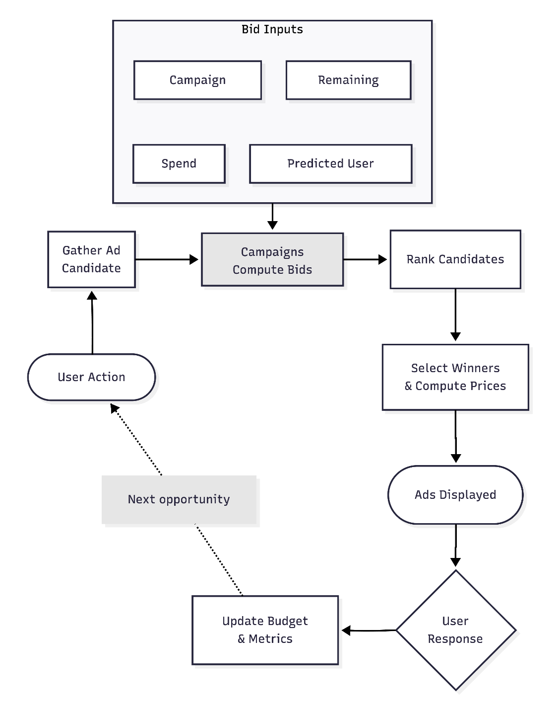
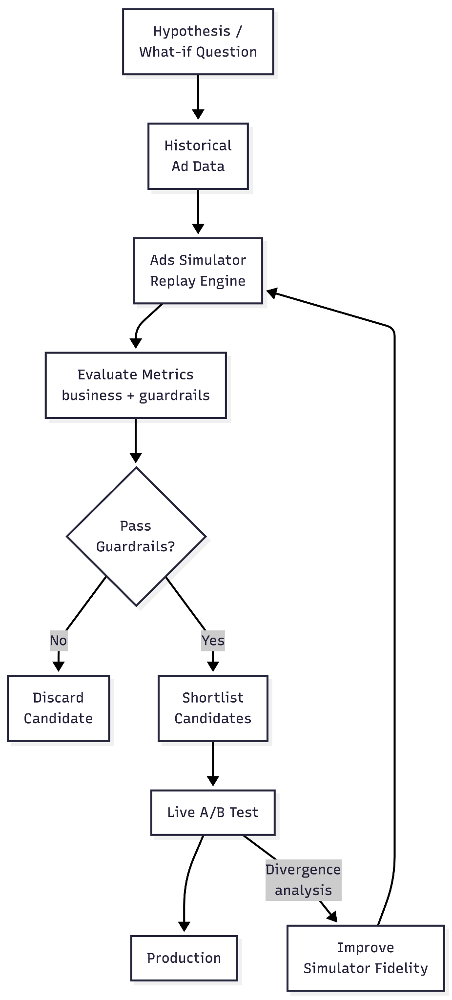
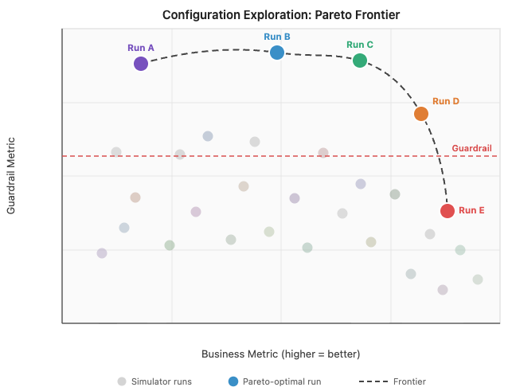
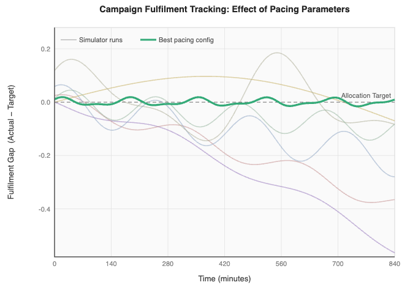

## Introduction

Ads delivery at Grab is increasingly an artificial intelligence (AI) decisioning problem. Every ad opportunity requires the system to infer user intent, predict engagement, balance advertiser returns, platform revenue, and user engagement, respect campaign budgets, and decide which ads should appear in a highly constrained product surface. As our ads systems become more complex, the range of bidding, ranking, and pacing strategies we need to evaluate grows with them. To continue improving quickly and safely, our approach to experimentation had to evolve: test more hypotheses offline, filter them against business and user guardrails, and reserve live traffic for the most promising ideas.

Live A/B tests remain the gold standard for testing changes, but they consume real traffic, take time to gather clear signals, and expose users and advertisers' budgets to unproven ideas. At Grab, we built an offline ads simulator to evaluate AI-driven bidding, ranking, and pacing strategies before they reach production. The simulator lets us replay historical ad opportunities, test alternative decision logic, measure business and user guardrails, and send a smaller, better-vetted set of configurations into live experiments, so each live test starts from an informed position rather than an open search.

*This is a two-post series. A second post covers how we extended this environment to train and validate generative bidders.*

## How an ad auction works

A simplified ad auction begins when a consumer action creates an ad opportunity: a user opens a food listing page or searches for a cuisine. The system gathers eligible ad candidates from merchant campaigns and evaluates them against the current context.

Each campaign decides how much to bid, drawing on its own configuration, its delivery state, and an estimate of how the user is likely to respond. The auction then ranks candidates, selects winners, and displays them. After the user sees or interacts with the ad, the campaign budget and performance metrics are updated.

This is a sequential decision-making problem. A decision made at noon can affect how much budget remains in the evening. For example, bidding too aggressively early in the day may exhaust a campaign's budget and prevent it from competing for better opportunities later. A simulator is therefore useful because it evaluates how decisions compound over time, rather than assessing each auction in isolation.

<figure>
  <figcaption align="middle">Figure 1. Workflow of an ad auction.</figcaption>
  </figure>

## The simulation-first experimentation workflow

### Why we built an ads simulator

When improving our ads system, we often begin with several candidate changes (hypotheses). A candidate is a proposed version of the system that we want to evaluate. There could be different parameter configurations for the current setup, a change to an existing component such as ranking or pacing, or an entirely new component such as a bidder.

Each candidate represents a "what if" question:

* What would happen to Return on Ad Spend (ROAS) if we paced campaigns more aggressively throughout the day?
* What would happen to conversions if we change the balance between ads and organic content?
* What would happen to ad spend if we use a new type of bidder for our ad campaigns?

Historically, we answered such questions using offline analysis, domain intuition, and A/B tests. These approaches work well for incremental changes, but become limiting when the search space grows. A single parameter can require many possible values. A policy can vary by time of day, city, campaign type, or other contextual features. A machine learning (ML) model can propose strategies that have never appeared in historical logs.

Live experimentation can also be noisy when metrics are strongly affected by daily traffic conditions. The same parameter configuration could look better or worse depending on the day on which it is tested. Testing a large candidate space in production would consume substantial traffic, take considerable time, and expose users and advertisers' budgets to unproven changes. These changes expose the business to risks, and can be mitigated by the use of our simulator.

The simulator allows us to evaluate these candidates first by replaying them across historical days, placements, and traffic conditions. Candidates that perform well only in a narrow slice can be filtered out, while those that remain stable and satisfy business and user guardrails can be shortlisted for live testing. The corresponding configuration or system change can progress to a focused A/B test.

The simulator does not replace live A/B tests. It improves the hypotheses that go into them, so each live experiment starts from a more informed position.

<figure>
  <figcaption align="middle">Figure 2. Simulation-first experimentation workflow.</figcaption>
  </figure>

### What the simulator replays

The simulator replays historical opportunities using the campaign, traffic, and contextual data observed in production. A data preparation step transforms these records into a consistent replay dataset.

For each opportunity, the simulation engine applies the candidate bidding and ranking strategy, determines which ads would be shown, and probabilistically generates downstream user responses from calibrated engagement models. It then updates campaign state before processing the next opportunity. This sequential replay captures how each decision affects later auctions and records the resulting campaign, advertiser, and platform metrics.

The system is modular by design. Each component (sampling, bidding, ranking, pricing, and metrics) is independently configurable. A team can swap out a bidding strategy without touching the ranking logic, or test a new metric without rerunning the pipeline from scratch. This makes it straightforward to keep the simulator in step with production as new features are built and existing ones evolve.

### Making the simulator trustworthy as an AI evaluation system

For AI-driven ads systems, a simulator is useful only if teams can trust its signals enough to make experimentation decisions. We treat simulator fidelity as an engineering requirement, not an assumption. The goal is not to predict every live outcome precisely, but to make offline comparisons meaningful enough to decide which model, policy, or strategy should move into live testing.

We validate this through regular fidelity checks across two levels. The first is mechanism level: each deterministic component is validated against production logic to ensure the simulator applies the same rules in the same order. The second is outcome level: we aggregate metrics from production against simulator outputs with production configurations. Key metrics are compared across equivalent traffic slices to confirm distributions align. Where gaps appear, they are investigated and the relevant component is updated before the simulator is used to evaluate new candidates.

These checks run regularly, not just at setup. As production systems evolve, they reveal where the simulator has diverged and which components need updating. This continuous validation keeps offline comparisons representative of current production behavior.

## Use case 1: Evaluating ranking and relevance tradeoffs with mix-ranking

When ads and organic candidates are ranked together, position affects user engagement, campaign spend, and advertiser outcomes. Organic candidates are non-paid results ranked by relevance, shown in the same placement as ads. Mix-ranking controls this tradeoff by deciding the final order shown to the user.

In this use case, the simulator replays historical requests with both ad and organic candidates available in the same placement context. The main parameter we evaluate, referred to here as alpha, adjusts the balance between ad and organic candidates in the final ordering. By running the same historical traffic across different alpha values, we can compare how the ranking changes before testing any candidate in production.

<figure>
  <figcaption align="middle">Figure 3. Illustrative configuration exploration. Axes are normalized; values are synthetic.</figcaption>
  </figure>

Ad and organic candidates are scored through their respective production scoring paths, which the simulator reproduces. Candidates are evaluated against guardrail criteria with business and engagement outcomes validated in downstream A/B experiments.

The simulator records the ad and organic winner mix by minute and placement, which helps explain whether a candidate improves ranking outcomes through better signal blending or simply by shifting surface area away from organic content. The output is a smaller set of alpha values for live A/B testing. Simulation narrowed the alpha parameter search space to a handful of values that held up across traffic conditions; these became the inputs to a more focused live A/B test, reducing experimentation iteration and increasing the velocity of improvement of our ads ecosystem.

## Use case 2: Evaluating sequential decision policies with budget pacing

Budget pacing is a sequential decision problem. A campaign that spends too quickly may exhaust its budget before later opportunities arrive. A campaign that spends too slowly may miss useful demand and finish underdelivered. The pacing policy has to manage this over the full day while preserving advertiser returns and avoiding unnecessary spend degradation.

The baseline pacing policy in production is a Proportional-Integral-Derivative (PID) controller, a standard feedback approach. It modulates how aggressively a campaign competes based on its delivery and how it is tracking against its target over the course of the day. PID controllers are well-suited to auction environments because they react continuously to feedback without requiring a model of the underlying system. In practice, however, they are difficult to tune: the controller exposes several parameters governing how strongly and how quickly it responds to deviations, and the right values are workload dependent. A misconfigured controller can overshoot, oscillate, or converge too slowly to be useful.

We used the simulator to evaluate an alternative based on Primal-Dual Adaptive Pacing (PDAP). PDAP is an optimization-based approach that treats the campaign budget as a constrained resource and continuously adjusts bid pressure to track the target spend curve. In practice, it tracks a single internal pressure signal and translates it into an adjustment on how aggressively the campaign competes, tightening when the campaign runs ahead of plan and loosening when it falls behind. PDAP has fewer free parameters than PID, which makes it a practical candidate to evaluate: if it can match or improve on PID's tracking behavior, it would reduce the tuning burden without sacrificing control quality.

The simulator lets us compare PID and PDAP under the same historical campaign conditions before either change touches live traffic. For each replay, the simulator advances campaign state over time, applies the active pacing policy, resolves resulting auctions, simulates downstream user response, and records campaign and platform metrics.

<figure>
  <figcaption align="middle">Figure 4. Campaign fulfilment tracking: effect of pacing parameters. Illustrative simulator runs.</figcaption>
  </figure>

Candidates are evaluated on business and engagement outcomes, and filtered by guardrails covering delivery, engagement, and how well it utilizes planned budget targets over the day. The simulator records fine-grained delivery and engagement traces, which makes it easier to inspect why a candidate behaves differently from the PID baseline. To mitigate risk, we filter out candidates exhibiting performance regressions on any guardrail, as well as unrealistic parameter configurations. Given the absence of a production baseline for this bidder, this pre-filtering step is essential to ensure operational stability before live testing. The candidates that remained showed comparable spend tracking to PID with fewer parameters to tune, reducing configuration burden, and moved into a focused live A/B test against the PID baseline.

## What we learned

Building the simulator taught us that it needs to be treated as a product, not a one-off analysis tool. A useful simulator needs reliable data preparation, clear configuration, repeatable runs, comparable metrics, and easy ways to inspect results. Without those, teams can run simulations but struggle to trust or act on them.

Fidelity is a moving target. A simulator can reproduce known auction mechanics faithfully and still be wrong when tested in a new regime. Mix-ranking required improvements to how organic candidates are modeled; without accurate organic behavior, the simulated blend between ads and organic results diverged from production. Budget pacing exposed how sensitive the pacing controller is to spend-signal timing. In the simulation, the controller used idealized, timely spend signals, while real-world deployments may involve variations in data freshness and availability. A controller tuned against perfect information can over-correct on stale numbers, and the feedback loop that looks stable offline can drift or spike live. Each new use case is likely to surface a different gap.

The most important lesson is that simulation and live experimentation are complements, not substitutes. Offline replay is fast, repeatable, and safe. Live experiments provide ground truth. When live results diverge from simulated ones, the gap is informative: it points to exactly where the simulator needs to improve. Over time, that feedback loop is what makes the simulator more useful, not just more used. Those lessons shaped what the team focused on next.

## Where we are heading

From the start, the goal was not just to replicate auction mechanics, but to build an environment where AI systems can be evaluated, compared, and improved before they touch live traffic. The use cases here, mix-ranking and budget pacing, represent the first layer of that: establishing a reliable baseline for offline evaluation.

The near-term focus is making the simulator easier to use: better tooling for parameter sweeps, clearer observability into why a simulation produced a given result, and support for a wider range of auction modes and pacing strategies.

The next layer is applying this environment to more complex AI systems. A follow-up post covers how we extended the simulator to train and validate generative bidders, where the model does not just react to the current state but proposes future pacing actions. That work builds directly on the evaluation infrastructure described here.

Simulation does not replace live tests. It reduces the candidate space, filters unsafe configurations, and gives live experiments better starting points. The shift is as much about process as it is about technology: moving simulation earlier in the workflow changes how teams approach risk and iteration. The use cases here show that the pattern works. The next step is extending it.

<small class="credits">
We gratefully acknowledge Allen Lin and Jianning Zhang from Grab's DNA Data Science team for sharing valuable insights into Grab's advertising systems and data, and for helping validate the simulator's fidelity. We also thank Ruike Zhang, Richard Ryu, Padarn George Wilson, and Weilun Wu for their support and guidance throughout this work.
</small>

## Join us

Grab is Southeast Asia's leading superapp, serving over 900 cities across eight countries (Cambodia, Indonesia, Malaysia, Myanmar, the Philippines, Singapore, Thailand, and Vietnam). Through a single platform, millions of users access mobility, delivery, and digital financial services, including ride-hailing, food delivery, payments, lending, and digital banking via GXS Bank and GXBank. Founded in 2012, Grab's mission is to drive Southeast Asia forward by creating economic empowerment for everyone while delivering sustainable financial performance and positive social impact.

Powered by technology and driven by heart, our mission is to drive Southeast Asia forward by creating economic empowerment for everyone. If this mission speaks to you, [join our team](https://grb.to/part_1_ads_simulation) today!
