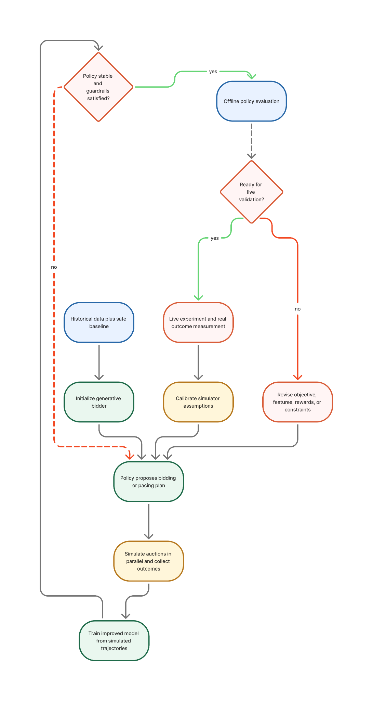
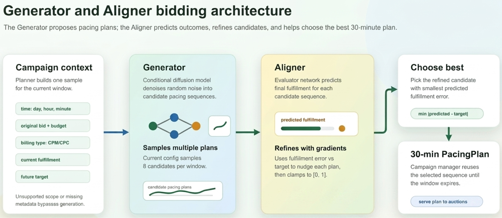
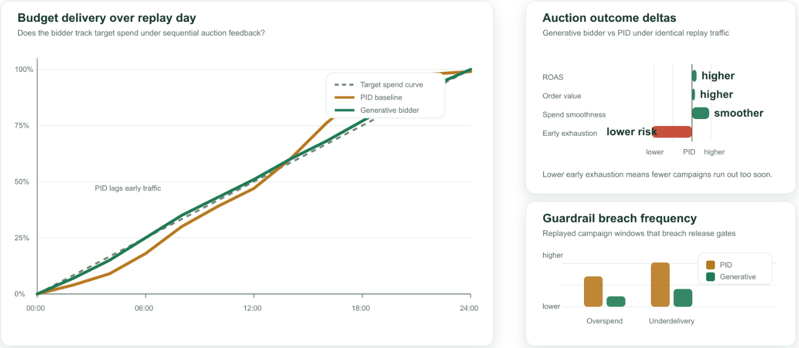

## Introduction

Grab runs marketplaces where many important decisions unfold over time, rather than as one-step predictions. Mobility systems need to anticipate how taxi demand and driver supply may evolve across locations and time windows. Food systems need to plan around changing order traffic, merchant capacity, and delivery demand. Ads has the same problem with merchant campaign budgets: traffic quality, user intent, and campaign spend opportunities change throughout the day.

Prediction models estimate what may happen next, such as demand, conversion likelihood, or expected engagement. Many Grab use cases need the system to go further: generate possible future trajectories or action plans, evaluate them against business constraints, and choose a safe path forward.

That is the problem generative models address. They can propose structured futures, such as demand-supply trajectories, order traffic scenarios, or budget pacing plans, conditioned on the current marketplace state and on business goals. Generated futures and generated actions cannot be trusted just because they look plausible. They need to be trained, evaluated, and stress-tested before they influence real users, merchants, drivers, or budgets. This is part 2 of 2. Read [Part 1](https://engineering.grab.com/part-1-simulation-first-ai-experimentation-for-ads-at-grab) where we discussed the ads simulator.

## Generative bidders for ads

In Grab Ads, the business problem is merchant budget delivery. An ideal campaign spends efficiently across auctions under uneven traffic, winning high-value opportunities while using its target budget. Controllers such as proportional-integral-derivative (PID) controllers are widely used in digital advertising, but they are reactive. They adjust bidding pressure only when a campaign is ahead of or behind its target, and they do not plan how spend should unfold over the next window. To improve ad auction bidding for Grab and its merchants, we propose a generative bidder that plans pacing actions, so campaigns can bid in ways that better serve user experience and business goals. The design follows the diffusion completer-aligner approach described by Li et al. (2025).

A generative bidder produces a short sequence of future pacing actions for a campaign. Ads can then plan budget delivery under marketplace constraints, and use simulation to train, validate, and stress-test those plans before they affect live merchant budgets.

<div class="post-image-section"><figure>
  <figcaption align="middle">Figure 1. Train in simulation, check the guardrails, and only then consider a live experiment.</figcaption>
  </figure>
</div>

[Part 1](https://engineering.grab.com/part-1-simulation-first-ai-experimentation-for-ads-at-grab) introduced the ads simulator. The simulator does two jobs here. It creates safe opportunities to explore pacing strategies while the bidder trains, and it checks whether those strategies are safe enough for a live test. Training teaches the model to produce plausible, useful pacing plans. Validation checks that those plans survive auction mechanics, budget constraints, delayed signals, and marketplace guardrails.

## Why generative bidders need simulation

A traditional budget pacing controller reacts to the gap between how much a campaign should have spent by now and how much it has actually spent. If a campaign underspends, the controller increases bidding pressure. If it overspends, the controller backs off. The pattern is reliable, and it is reactive.

A generative bidder plans ahead. Instead of one adjustment for the current auction, it generates a sequence of pacing actions for a short future window, on the order of tens of minutes. The plan is conditioned on campaign state, time, budget, billing type, current fulfillment progress, the allocation target, and return on ad spend (ROAS) goals.

The simulator does more than score the bidder after training. It also generates training data. Candidate pacing plans run through simulated auctions, and the resulting trajectories, budget movement, fulfillment progress, ROAS, and guardrail metrics are recorded as training examples. The Generator learns which pacing sequences are realistic. The Aligner learns how those sequences affect delivery and efficiency.

The system can then propose different spend shapes over the next window. One plan may spend steadily. Another may hold back early and bid more aggressively later. A third may increase pressure when the model expects higher-value traffic. Simulation lets us explore these alternatives safely, learn from their outcomes, and test the resulting bidder before it affects real merchants.

## Core components: Generator and Aligner

<div class="post-image-section"><figure>
  <figcaption align="middle">Figure 2. Generator and Aligner architecture.</figcaption>
  </figure>
</div>


The bidder uses a generate-then-align architecture. The Generator proposes a 30-minute pacing plan, represented as a sequence x = [p₁, …, p₃₀], where each pᵢ ∈ [0, 1] and is the pacing action for one minute. The Aligner evaluates each plan by predicting its final fulfillment progress and ROAS.

### Generator

Let x₀ be a real pacing sequence from historical logs or from simulator-generated training data, and let c represent the campaign context and target outcomes. During training, the diffusion process adds Gaussian noise to x₀:

```text
xₜ = √(ᾱₜ) x₀ + √(1 − ᾱₜ) ε, ε ~ 𝒩(0, I)
```

The Generator learns to predict the noise that was added:

```text
L_gen = 𝔼[‖ε − εθ(xₜ, t, c)‖²]
```

At serving time, the Generator starts from random noise and reverses this process to produce candidate pacing plans. Classifier-free guidance steers generation toward the requested targets:

```text
ε_guided = ε_uncond + s(ε_cond − ε_uncond)
```

### Aligner

The Aligner receives the campaign context and a candidate pacing trajectory, then predicts the expected outcome:

```text
ŷ = Aϕ(c, x)
```

The planner compares these predictions with the desired campaign targets:

```text
J(x; c) = Σₘ wₘ ρ(ŷₘ − yₘ*)
```

Here, yₘ* is the target for metric m, w_m controls its importance, and rho is an error function. The target metrics may represent revenue, budget utilization, or other business objectives.

### Inference-time refinement

Because the Aligner is differentiable, the planner can refine the pacing actions at inference time without changing the Generator or Aligner weights. For candidate j at refinement step k, it computes the gradient of the objective with respect to the pacing trajectory:

```text
gⱼ⁽ᵏ⁾ = ∇ₓ J(xⱼ⁽ᵏ⁾; c)
```

It then updates the trajectory in the direction that reduces the predicted error, and clamps each action to [0, 1]:

```text
xⱼ⁽ᵏ⁺¹⁾ = clip(xⱼ⁽ᵏ⁾ − αₖgⱼ⁽ᵏ⁾, 0, 1)
```

The planner generates and refines multiple candidate trajectories, then selects the one with the lowest target error:

```text
x* = argminⱼ J(xⱼ; c)
```

The Generator produces realistic and diverse pacing plans. The Aligner makes them goal-aware by refining them toward defined targets. The simulator supplies the historical and simulated trajectories used to train both components, and it is the environment used to validate the refined plans.

## Training: from historical behavior to simulator-driven learning

Training starts with historical behavior. Production data shows how campaigns paced spend under existing controllers. This phase gives the bidder a safe baseline: daily traffic rhythms, campaign-level differences, budget pressure, and the relationship between pacing actions and observed outcomes.

This is behavioral cloning. It is a useful initialization, and it can also reproduce limits in the historical data or in the existing control strategies. The model should learn from production behavior without being restricted to copying it.

The simulator is what lets training move past that baseline. In simulator-driven training, candidate bidders run against replayed historical traffic. The loop collects trajectories and outcomes, and uses those outputs to improve the next model version. Weak strategies can fail offline. Promising strategies can be reinforced across many simulated campaign states. The model can explore pacing plans that would be too risky to test directly in production.

### Training at scale with the simulator and Ray

Simulator-driven training is a modeling problem and a distributed systems problem. A useful training round has to replay many historical traffic slices, run candidate policies through the simulator, collect trajectory-level outcomes, train the Generator and Aligner, and register a new model version. Doing that serially would make iteration too slow.

[Ray](https://docs.ray.io/), a distributed computing framework, gives this loop its throughput. A single simulator run can replay one day of traffic and process multiple auction requests. A training round can launch independent simulator workers across different historical dates, campaign slices, or candidate policy versions. Each worker loads its assigned auction data, runs the bidder through replayed traffic, and writes pacing trajectories, spend movement, fulfillment progress, ROAS, and guardrail metrics back to storage.

Ray runs this orchestration as a cluster workload, rather than as a notebook or a one-off batch script. It allocates resources across simulation and training workers, keeps independent replay jobs running concurrently, and gives the loop a way to retry or replace failed work. Inside each simulator, auction processing can still use local parallelism for groups of auction requests. Ray handles parallelism across days, markets, model candidates, and training phases.

The output of this fan-out becomes the next training dataset. The Generator learns from pacing trajectories. The Aligner learns from observed end-of-window outcomes. After training, the updated models are registered as versioned artifacts that can move into validation.

The combined simulator and Ray layer matters for three reasons:

- Scale. The model can learn from many simulated days or campaign states in one training round, instead of waiting for sequential replay.
- Diversity. Parallel simulation can cover different traffic patterns, markets, campaign types, and policy variants, which reduces the chance that the model overfits to one historical slice.
- Repeatability. Each training round can be tied to a specific dataset window, simulator configuration, model version, and validation report, which makes failures easier to diagnose.

### The training loop

The training loop has seven steps:

1. Start with historical production data to learn a safe baseline.
2. Train the initial Generator and Aligner on observed pacing sequences and outcomes.
3. Launch parallel simulator runs across campaign states, traffic patterns, dates, markets, and candidate policies.
4. Let the candidate bidder act inside simulated auctions.
5. Collect trajectories, including bid plans, auction responses, budget movement, fulfillment progress, ROAS, and guardrail metrics.
6. Train an improved model from successful and failed strategies.
7. Register the updated Generator and Aligner as versioned artifacts for validation.

Generation, execution, and learning stay connected. The model does not imitate old pacing behavior once and then stop. It proposes plans, the simulator shows the consequences, training absorbs those consequences, and the next model version gets another chance to plan better.

## Validation: from model metrics to marketplace safety

Training asks whether the model can learn. Validation asks whether the learned policy should be trusted.

For generative bidders, validation has to happen at several levels. A model can have a good validation loss and still be unsafe in the auction loop. A generated sequence can look realistic and still underspend. An Aligner can predict well on historical trajectories and still misjudge trajectories from a new Generator. Validation is a separate gate after training, not a side effect of it.

### Level 1: dataset and model validation

The first validation layer checks whether the training pipeline and the model are internally sound.

For the Generator, the training code keeps a time-based validation split and logs validation loss, the mean difference of reconstructed sequences, and distribution divergence. The evaluation review adds visual trajectory inspection, distribution fidelity checks, Wasserstein distance between generated and real pacing sequences, and conditioning sensitivity tests. These checks answer basic questions: do generated pacing plans follow real pacing rhythms, do their values occupy a plausible range, and do they change when campaign context changes?

For the Aligner, validation tracks whether the model predicts fulfillment progress and ROAS on held-out windows. It logs fulfillment and ROAS losses, mean absolute error (MAE), and mean squared error (MSE). These metrics matter because the Aligner guides candidate selection. If it overpredicts fulfillment progress, the planner may treat a campaign as on track when the campaign is underspending.

This layer is necessary, and it is not sufficient. It validates the learned components in isolation. The next layer validates the bidder as a decision system.

### Level 2: simulator validation against auction dynamics

<div class="post-image-section"><figure>
  <figcaption align="middle">Figure 3. Simulator-based validation.</figcaption>
  </figure>
</div>

The simulator validation layer replays the bidder inside the auction environment.

The question changes from whether the model predicts well to what happens when this bidder controls pacing over time. The simulator compares the generative bidder with the existing PID-style pacing baseline under the same historical traffic and campaign conditions. It measures budget adherence, ROAS, order value, spend smoothness, early budget exhaustion, and guardrail violations, to determine that the generative bidder improves on PID without compromising delivery or efficiency.

### Level 3: stress testing and guardrails

A generative bidder also needs scenario validation. The simulator can stress the policy under cases that may be rare or risky in live traffic:

- Sudden traffic spikes during high-value periods.
- Campaigns that are behind target late in the day.
- Campaigns with sparse or delayed conversion signals.
- Markets with different budget and currency behavior.
- Generated plans that approach budget exhaustion too early.

These stress tests make safety a training and release gate. The bidder should do more than look good on average. It should fail gracefully when the market surprises it.

## Deployment: staged live handoff and calibration

Deployment comes after the training and validation gates. A candidate first passes dataset and model validation. It then passes simulator validation against the baseline and the guardrails. It then enters a scoped live experiment.

At serving time, the planner uses the trained Generator and Aligner to create short-lived pacing plans. It generates multiple candidate trajectories, refines them with the Aligner, selects the best plan, executes that plan for the next window, and refreshes the plan when the window expires. The deployed system keeps the same generate, align, select, and refresh pattern used in offline development, under live production constraints.

Live experiments remain the source of truth. The simulator can reduce risk, narrow the candidate set, and expose bad policies early. It cannot replace production evidence. After a live result lands, the gap between simulated and live outcomes becomes calibration data for the next simulator version.

That feedback matters because simulator fidelity moves. As the bidder enters regimes that historical controllers never explored, the simulator has to keep learning too.

## Conclusion

This work explores a shift from models that primarily predict outcomes toward generative algorithms that propose candidate actions, plans, and strategies. The framing is specific to this system. It does not describe a company-wide direction.

Many Grab marketplace problems unfold over time. Mobility systems need to reason about future demand and supply. Food systems need to anticipate order traffic and capacity. Ads systems need to decide how merchant budgets should move across uneven traffic while protecting ROAS, revenue, and user experience. In each case, the opportunity is to generate possible futures or action plans and test which ones are safe and useful, not only to predict what may happen.

For Ads, generative bidders are an early example. Instead of reacting auction by auction, a bidder can generate a short pacing plan for the next window, conditioned on campaign state, budget pressure, traffic context, and business goals. The simulator is the environment where these generated plans can be trained, compared, stress-tested, and filtered before they reach production.

The longer-term direction is to make this simulation-to-live loop a standard path for generative algorithms. Offline simulation can identify promising candidates, reject unsafe ones, and expose where a strategy is sensitive to specific traffic slices. Live experiments can then validate a smaller, stronger candidate set and feed real outcomes back into simulator calibration.

The goal is to build the infrastructure that lets Grab move safely toward generative decision-making: generate broadly, validate rigorously, launch narrowly, and learn continuously from production.

<small class="credits">
We gratefully acknowledge Allen Lin and Jianning Zhang from Grab's DNA Data Science team for sharing valuable insights into Grab's advertising systems and data, and for helping validate the simulator's fidelity. We also thank Ruike Zhang, Richard Ryu, Padarn George Wilson, and Weilun Wu for their support and guidance throughout this work.
</small>

## Join us

Grab is Southeast Asia's leading superapp, serving over 900 cities across eight countries (Cambodia, Indonesia, Malaysia, Myanmar, the Philippines, Singapore, Thailand, and Vietnam). Through a single platform, millions of users access mobility, delivery, and digital financial services, including ride-hailing, food delivery, payments, lending, and digital banking via GXS Bank and GXBank. Founded in 2012, Grab's mission is to drive Southeast Asia forward by creating economic empowerment for everyone while delivering sustainable financial performance and positive social impact.

Powered by technology and driven by heart, our mission is to drive Southeast Asia forward by creating economic empowerment for everyone. If this mission speaks to you, [join our team](https://www.grab.careers/en/) today!


## References 

Li, Y., Gao, J., Jiang, N., Mao, S., An, R., Pan, F., Zhao, X., An, B., Cai, Q., and Jiang, P. (2025). Generative auto-bidding in large-scale competitive auctions via diffusion completer-aligner. arXiv. <https://doi.org/10.48550/arXiv.2509.03348>